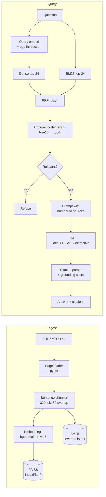

# Enterprise RAG

**Document intelligence with hybrid retrieval, cross-encoder reranking, and page-level citations.**


An end-to-end retrieval-augmented generation service over a PDF corpus. Ask a
question, get an answer where **every claim carries a citation that resolves to a
specific document and page number** — or an explicit refusal when the corpus does
not contain the answer.

Built to demonstrate the parts of RAG that are hard: chunking that preserves
provenance, hybrid retrieval, reranking, grounding enforcement, and a real
evaluation harness.

---

## Table of contents

- [Why this exists](#why-this-exists)
- [Architecture](#architecture)
- [Evaluation](#evaluation)
- [Quickstart](#quickstart)
- [Using your own documents](#using-your-own-documents)
- [Configuration](#configuration)
- [API](#api)
- [Design decisions](#design-decisions)
- [Project structure](#project-structure)
- [Limitations and next steps](#limitations-and-next-steps)

---

## Why this exists

Most "chat with your PDF" projects stop at embed → cosine search → dump into a
prompt. They work in a demo and fail the moment someone asks a question the
embedding model finds semantically similar but factually different — or asks
about a number buried on page 9 of a 40-page policy.

This project implements the four stages that actually decide answer quality, and
measures each one:

| Stage | Problem it solves | Implementation |
|---|---|---|
| **Page-scoped chunking** | Citations are unverifiable if a chunk spans pages | Sentence-aware packing, never crosses a page boundary |
| **Hybrid retrieval** | Dense embeddings smear exact identifiers (`429`, `Five-0-0`); BM25 misses paraphrases | FAISS + BM25, fused with Reciprocal Rank Fusion |
| **Cross-encoder reranking** | Top-20 recall is easy, top-1 precision is not | `ms-marco-MiniLM-L-6-v2` sees query and passage together |
| **Grounding enforcement** | LLMs invent confident, uncited answers | Citation parsing, grounding score, relevance-threshold refusal |

---

## Architecture



Everything runs on CPU. No GPU, no paid API required.

---

## Evaluation

The repo ships with a **32-question golden set** whose answers were verified by
hand against specific pages, plus an ablation harness that measures what each
stage contributes.

```bash
make eval                                            # extractive baseline, ~5s
.venv/bin/python evals/run_eval.py --provider local  # with the local LLM
```

**Retrieval ablation** (identical for both backends):

```
Retrieval ablation (n=32 questions, k=5)

mode              recall@k       MRR     latency
------------------------------------------------
dense                1.000     0.969        9.6ms
bm25                 0.969     0.969        6.0ms
hybrid               1.000     0.969        6.4ms
hybrid+rerank        1.000     1.000       48.2ms
```

**Answer quality**, same retrieval, two different generation backends:

| Backend | Answer accuracy | Grounded rate | Citation page accuracy | Mean latency |
|---|---|---|---|---|
| `extractive` (no LLM) | 0.875 | 1.000 | **1.000** | 53 ms |
| `Qwen2.5-1.5B-Instruct` (local, CPU) | **0.906** | 0.812 | 0.688 | 1,300 ms |

**The interesting result.** The LLM answers more questions correctly (0.906 vs
0.875) but attributes them far less reliably (0.688 vs 1.000). A 1.5B model on CPU
knows the fact but drifts toward `[1]` when the supporting passage is `[3]`. That
is precisely why citation correctness is validated in application code — mapping
markers to real chunks, pages and snippets — rather than trusted from the model.
It is also why the extractive provider earns its place: it is duller to read, but
every sentence it emits is verbatim from a cited page.

Generation uses greedy decoding (`RAG_TEMPERATURE=0`), so these numbers are
bit-for-bit reproducible across runs.

**How to read the recall numbers honestly.** `recall@5` hits 1.000 for dense
retrieval because the sample corpus is 25 chunks — small enough that semantic
search already saturates. The number that separates the configurations is **MRR**:
reranking lifts the correct page to rank 1 in every case, which is exactly the
effect it is supposed to have. On a real corpus of thousands of chunks, absolute
recall drops substantially (typically 0.70–0.90 in my experience) and the gap
between dense, hybrid and reranked widens. The harness is the deliverable here,
not the saturated numbers — point `evals/golden_set.jsonl` at your own documents
and it reports the truth.

Both runs are committed: `evals/results.json` (local LLM) and
`evals/results_extractive.json` (baseline).

---

## Quickstart

```bash
git clone <your-repo-url> && cd rag-enterprise

make install          # venv + dependencies
make corpus           # generate 8 sample PDFs (25 pages)
make ingest           # embed, index, measure
make run              # http://localhost:8000
```

Open <http://localhost:8000> and ask:

> How many days of paid annual leave do employees receive?

You should get an answer citing **Northwind Employee Handbook, page 2**.

### Which LLM will it use?

`RAG_LLM_PROVIDER=auto` picks the best option that works on your machine without
triggering a surprise 3 GB download:

1. **Local model**, if `RAG_LLM_MODEL` is already in your HF cache → `make pull-model` to pre-fetch
2. **Hugging Face Inference API**, if `HF_TOKEN` is set (free tier)
3. **Extractive fallback**, otherwise — sentence selection, zero hallucination

All three are interchangeable. The extractive path is not a stub: it is a
legitimate answer mode and the baseline the eval harness compares against.

```bash
# option A: local, free, private
make pull-model
RAG_LLM_PROVIDER=local make run

# option B: HF Inference API (free tier)
export HF_TOKEN=hf_...
RAG_LLM_PROVIDER=hf_api make run
```

---

## Using your own documents

Drop PDFs, Markdown or text files into `data/docs/` and reindex:

```bash
cp ~/Documents/*.pdf data/docs/
make ingest
```

Or upload through the UI (**Upload PDF**) or the API:

```bash
curl -F "files=@report.pdf" http://localhost:8000/api/upload
```

Then point the eval harness at your corpus by editing `evals/golden_set.jsonl`:

```json
{"id": "q01", "question": "...", "doc": "report.pdf", "page": 7, "expect": ["some expected fact"]}
```

---

## Configuration

Every value in `.env.example` maps to an environment variable. The ones that
matter most:

| Variable | Default | Why you would change it |
|---|---|---|
| `RAG_CHUNK_TOKENS` | `320` | Larger chunks = more context per citation, less precise retrieval |
| `RAG_RERANK_TOP_K` | `16` | Reranker pool size; the main latency/quality dial |
| `RAG_FINAL_TOP_K` | `6` | How many passages reach the prompt |
| `RAG_MIN_RERANK_SCORE` | `-6.0` | Refusal threshold. Lower = more permissive, more hallucination risk |
| `RAG_LLM_PROVIDER` | `auto` | `extractive` for deterministic, auditable answers |
| `RAG_USE_REAL_MODELS` | `1` | `0` swaps in hashed embeddings for fast tests/CI |

Full list: [`app/config.py`](app/config.py).

---

## API

| Method | Path | Purpose |
|---|---|---|
| `POST` | `/api/ask` | Ask a question, get answer + citations + stage trace |
| `POST` | `/api/ingest` | Rebuild the index from `data/docs` |
| `POST` | `/api/upload` | Upload documents and reindex |
| `GET` | `/api/stats` | Corpus and model summary |
| `GET` | `/api/health` | Readiness and provider status |
| `GET` | `/metrics` | Prometheus-format counters and latency |

```bash
curl -s http://localhost:8000/api/ask \
  -H 'Content-Type: application/json' \
  -d '{"question": "What is the maximum discount an account executive can approve?"}' \
| jq '{answer, citations, grounded, latency_ms}'
```

```json
{
  "answer": "Account executives may approve discounts up to 15 percent [1].",
  "citations": [
    {
      "index": 1,
      "doc_title": "Northwind Sales Playbook",
      "page_number": 2,
      "source_path": "Northwind_Sales_Playbook.pdf"
    }
  ],
  "grounded": true,
  "latency_ms": 270.3
}
```

Every response also carries a `trace` array with per-stage timings, so latency
regressions are attributable to a specific stage rather than "the app got
slower".

---

## Design decisions

**FAISS over a vector database.** `IndexFlatIP` over L2-normalised vectors is
exact cosine search. At 25–100k chunks it is sub-millisecond on CPU and needs no
service to operate. Qdrant or pgvector would add filtering and persistence
guarantees I do not need yet; the `VectorStore` interface is narrow enough to
swap.

**Page-scoped chunking.** Chunks never span pages, so `page_number` is always
correct. The alternative — chunking the whole document then mapping offsets back
to pages — produces citations that are right 95% of the time, which is worse than
useless in a compliance context.

**Reciprocal Rank Fusion over score normalisation.** Dense cosine scores and BM25
scores live on incompatible scales. RRF only uses ranks, so there is nothing to
tune and it is robust to either retriever having a bad day.

**Refusal as a first-class outcome.** If the best reranked passage falls below
`RAG_MIN_RERANK_SCORE`, the pipeline returns a fixed refusal without calling the
LLM. That is both safer and faster — and it is why the "boiling point of water"
test returns a clean refusal rather than a creative answer.

**Provider abstraction with an extractive floor.** Three LLM backends behind one
interface means the project runs for someone with no API key, no GPU, and no
patience for a 3 GB download — while still being a genuine RAG system, not a toy.

**Instrumentation without a framework.** `/metrics` is hand-rolled in ~50 lines
rather than pulling in `prometheus_client`. The point of the exercise is showing
that the pipeline is instrumented at every stage.

---

## Project structure

```
rag-enterprise/
├── app/
│   ├── config.py              # every knob, env-overridable
│   ├── models.py              # pydantic schemas shared across layers
│   ├── service.py             # index + provider lifecycle
│   ├── main.py                # FastAPI routes and static UI
│   ├── observability.py       # stage timers, JSON logs, /metrics
│   ├── ingestion/
│   │   ├── loaders.py         # PDF/MD/TXT → pages (page numbers preserved)
│   │   ├── chunker.py         # sentence-aware, page-scoped chunking
│   │   └── pipeline.py        # ingest → embed → persist
│   ├── retrieval/
│   │   ├── embeddings.py      # bge-small + hashed fallback
│   │   ├── vector_store.py    # FAISS with numpy fallback
│   │   ├── bm25.py            # lexical retrieval
│   │   ├── reranker.py        # cross-encoder + lexical fallback
│   │   └── pipeline.py        # hybrid → RRF → rerank
│   └── generation/
│       ├── providers.py       # local / HF API / extractive
│       └── rag.py             # prompt, citations, grounding, refusal
├── ui/                        # vanilla JS chat UI with citation chips
├── evals/                     # golden set + ablation harness
├── scripts/                   # sample corpus, ingest, CLI ask
├── tests/                     # 19 tests, no model downloads
├── Dockerfile / docker-compose.yml
└── .github/workflows/ci.yml
```

---

## Limitations and next steps

Stated plainly, because knowing where a system breaks is part of the design:

- **Single-tenant, in-process index.** No per-user access control on chunks. A
  real deployment needs document-level ACLs applied before retrieval, not after.
- **No OCR.** Scanned PDFs produce empty text. `pytesseract` or a vision model
  would be the fix.
- **Small eval set.** 32 questions is enough to catch regressions, not enough to
  claim statistical confidence. 200+ with inter-annotator agreement would be.
- **Answer grounding is measured by citation presence**, not entailment. An NLI
  verifier (or `ragas` faithfulness) would catch "cited but unsupported" claims.
- **No conversation memory.** Each question is independent; multi-turn would need
  query rewriting against the history.

Natural next steps: streamed responses, incremental indexing on upload,
document-level filters in the API, and an NLI-based faithfulness check in CI.

---

## License

MIT
