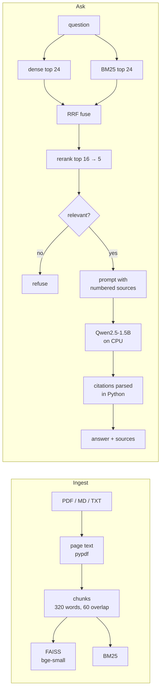

# Enterprise RAG

**Document intelligence with hybrid retrieval, cross-encoder reranking, and page-level citations.**


Ask a question about a folder of PDFs and get an answer where every claim carries
a citation that resolves to a **specific document and page** — or an explicit
refusal when the documents don't contain the answer.

Five Python files. No frameworks beyond FastAPI. Read `rag.py` top to bottom and
you know how the retrieval works.

---

## Table of contents

- [The idea](#the-idea)
- [How it works](#how-it-works)
- [Evaluation](#evaluation)
- [Quickstart](#quickstart)
- [Using your own documents](#using-your-own-documents)
- [Settings](#settings)
- [API](#api)
- [Design decisions](#design-decisions)
- [Project structure](#project-structure)
- [Limitations](#limitations)

---

## The idea

Most "chat with your PDF" demos are embed → cosine search → paste into a prompt.
They break the moment a question needs an exact number buried on page 9, or a term
the embedding model considers "similar" but means something else.

Four stages decide whether the answer is right, and this project does all four:

| Stage | Problem it solves | Where |
|---|---|---|
| **Chunk by page** | A citation is unverifiable if the chunk spans pages | `rag.py` |
| **Hybrid retrieval** | Embeddings blur exact identifiers; BM25 misses paraphrases | `rag.py` |
| **Cross-encoder rerank** | Top-20 recall is easy, top-1 precision is not | `rag.py` |
| **Citation checking** | LLMs invent confident answers and wrong markers | `answer.py` |

---

## How it works



1. **Load** — every page is read separately, so page numbers survive.
2. **Chunk** — sentences are packed into ~320-word windows that never cross a page.
3. **Index** — the same chunks go into FAISS (meaning) and BM25 (exact words).
4. **Search** — both lists are merged with Reciprocal Rank Fusion, then a
   cross-encoder reads each candidate next to the question and reorders them.
5. **Answer** — the top 5 passages are numbered and given to a local model that
   must cite `[n]`. Citations are then parsed, validated and mapped to pages *in
   Python*, never trusted from the model.

Runs on CPU. No API key, no GPU, $0 per query.

---

## Evaluation

`eval_set.jsonl` holds **32 questions** whose answers were checked by hand against
specific pages. `eval.py` measures each retrieval stage separately, then the
answers.

```bash
.venv/bin/python eval.py              # local LLM
RAG_USE_LLM=0 .venv/bin/python eval.py # extractive baseline, ~40 ms/answer
```

**Retrieval** (n=32, k=5):

```
mode         recall      MRR    latency
---------------------------------------
dense         1.000    0.969      9.7ms
bm25          0.969    0.969      5.7ms
hybrid        1.000    0.969     11.5ms
rerank        1.000    1.000     41.9ms
```

**Answers**, same retrieval, two ways of generating:

| Mode | Answer accuracy | Grounded | Citation page accuracy | Mean latency |
|---|---|---|---|---|
| extractive (no LLM) | 0.875 | 1.000 | **1.000** | 42 ms |
| `Qwen2.5-1.5B-Instruct` on CPU | 0.875 | 0.938 | 0.656 | 1,181 ms |

**The interesting result.** The LLM and the dumb sentence picker are equally
accurate here — but the LLM cites the wrong page a third of the time. A 1.5B model
knows the fact and still writes `[2]` when the supporting passage is `[4]`. That is
exactly why citation parsing lives in application code: the model proposes, Python
verifies. The extractive mode is duller to read but every sentence is verbatim
from a cited page.

**Be honest about the recall numbers.** The sample corpus is only 25 chunks, so
dense recall saturates at 1.000 — there is nothing to find and miss. The number
that separates the configurations is **MRR**: reranking puts the correct page at
rank 1 every time. On a corpus of thousands of chunks absolute recall would drop
and the gap between dense, hybrid and reranked would widen. Point
`eval_set.jsonl` at your own documents and the harness reports the truth.

Raw output is in `results_local.json` and `results_extractive.json`.
Decoding is greedy, so the numbers reproduce exactly.

---

## Quickstart

```bash
git clone <your-repo-url> && cd rag-enterprise

make install      # venv + dependencies
make corpus       # generate 8 sample PDFs (25 pages)
make ingest       # embed and index
make run          # http://localhost:8000
```

Ask it:

> How many days of paid annual leave do employees receive?

You should get an answer citing **Northwind Employee Handbook, page 2**.

### Which model answers?

`Qwen/Qwen2.5-1.5B-Instruct` runs locally on CPU (~3 GB, downloaded once).

```bash
make pull-model                  # pre-download it
.venv/bin/uvicorn app:app --port 8000

RAG_USE_LLM=0 make run           # skip the model, answer extractively
```

If the model can't load — no download, no memory — the app quietly falls back to
extractive answers instead of failing the request.

---

## Using your own documents

Drop PDFs, Markdown or text into `data/docs/` and reindex:

```bash
cp ~/Documents/*.pdf data/docs/
make ingest
```

Or upload from the UI, or with curl:

```bash
curl -F "files=@report.pdf" http://localhost:8000/api/upload
```

To evaluate on your corpus, edit `eval_set.jsonl` — one JSON object per line:

```json
{"id": "q01", "question": "...", "doc": "Report Title", "page": 7, "expect": ["48 hours"]}
```

`doc` is the filename without extension, spaces instead of underscores.

---

## Settings

Every number that matters is a constant at the top of `rag.py`, `answer.py` or
overridable by environment variable:

| Variable | Default | Effect |
|---|---|---|
| `RAG_DOCS_DIR` | `data/docs` | Where documents are read from |
| `RAG_INDEX_DIR` | `data/index` | Where the index is saved |
| `RAG_EMBED_MODEL` | `BAAI/bge-small-en-v1.5` | Embedding model |
| `RAG_RERANK_MODEL` | `cross-encoder/ms-marco-MiniLM-L-6-v2` | Reranker |
| `RAG_LLM_MODEL` | `Qwen/Qwen2.5-1.5B-Instruct` | Answering model |
| `RAG_USE_LLM` | `1` | `0` = extractive answers only |

Tuning constants (`CHUNK_TOKENS`, `RERANK_POOL`, `FINAL_TOP_K`, `MIN_SCORE`) are
plain names in `rag.py`.

---

## API

| Method | Path | Purpose |
|---|---|---|
| `POST` | `/api/ask` | Question → answer, citations, sources |
| `POST` | `/api/ingest` | Rebuild the index from `data/docs` |
| `POST` | `/api/upload` | Upload documents and reindex |
| `GET` | `/api/stats` | Corpus and model summary |
| `GET` | `/api/health` | Readiness |

```bash
curl -s localhost:8000/api/ask -H 'Content-Type: application/json' \
  -d '{"question": "What is the maximum discount an account executive can approve?"}' \
| jq '{answer, citations, grounded}'
```

```json
{
  "answer": "Account executives may approve discounts up to 15 percent [1].",
  "citations": [
    {"index": 1, "doc": "Northwind Sales Playbook", "page": 2, "snippet": "..."}
  ],
  "grounded": true
}
```

The response also carries `sources` (each passage with its dense rank, BM25 rank
and rerank score), `grounding_score`, `provider`, and `retrieval_ms` /
`generation_ms` so you can see where the time went.

---

## Design decisions

**Five files, not twenty.** Ingestion, retrieval, generation and the web layer
are separate concerns but not separate *abstractions*. Packages, interfaces and
fallback implementations were removed: if you want to know how chunking works,
open `rag.py` and read the function.

**FAISS over a vector database.** `IndexFlatIP` on L2-normalised vectors is exact
cosine search — sub-millisecond at 25–100k chunks, no service to run.

**Chunks never cross a page.** Chunking the whole document and mapping offsets
back produces citations that are right 95% of the time, which is worse than
useless in a compliance context.

**RRF over score normalisation.** Dense and BM25 scores live on different scales.
RRF uses ranks only, so there's nothing to tune and no retriever can dominate.

**Refusal is a real outcome.** If the best reranked passage scores below
`MIN_SCORE`, the answer is a fixed refusal and the LLM is never called. That's why
"what is the boiling point of water" gets a clean refusal, not a creative answer.

**Citations are enforced, not requested.** The prompt asks for `[n]`; the parser
then drops any marker that isn't a real retrieved chunk, and `normalize_citations`
rewrites the `(Source 3)` form the model sometimes emits. Grounding is reported as
the fraction of answer sentences with a valid citation.

---

## Project structure

```
rag-enterprise/
├── rag.py            # load → chunk → index → search (FAISS + BM25 + rerank)
├── answer.py         # prompt → LLM or extractive → citations → grounding
├── app.py            # FastAPI routes + static UI
├── ingest.py         # build the index:  python ingest.py
├── eval.py           # ablation + answer metrics:  python eval.py
├── make_corpus.py    # generates the 8 sample PDFs
├── eval_set.jsonl    # 32 hand-checked questions
├── ui/               # vanilla JS chat UI with clickable citations
├── tests/            # 18 tests
├── Dockerfile / docker-compose.yml
└── .github/workflows/ci.yml
```

---

## Limitations

Stated plainly, because knowing where a system breaks is part of the design:

- **Attribution is weak with a 1.5B model.** 0.656 citation-page accuracy means
  the fact is often right and the marker wrong. A larger model, or a verifier that
  scores each candidate sentence against the source, is the fix.
- **Single-tenant, in-process index.** No per-user access control. A real
  deployment needs document ACLs applied *before* retrieval.
- **No OCR.** Scanned PDFs yield empty text.
- **32 questions** is enough to catch regressions, not to claim confidence.
- **Grounding = citation presence**, not entailment. An NLI check would catch
  "cited but unsupported" claims.
- **No conversation memory.** Each question is independent.

Next: streamed responses, incremental indexing on upload, document-level filters,
and an NLI faithfulness check in CI.

---

## License

MIT
